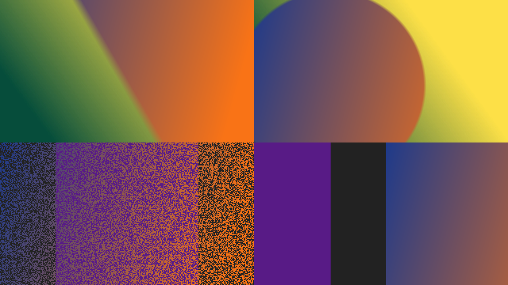
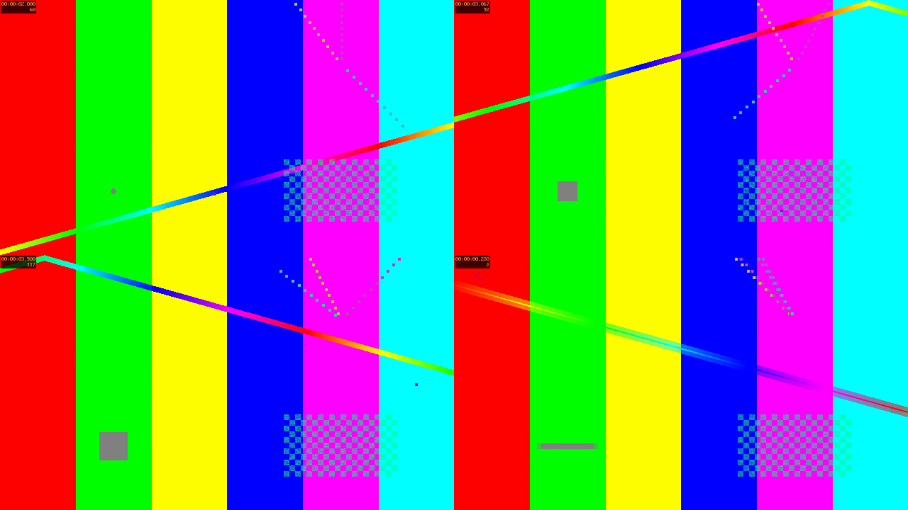

# surw — демон обоев HyprSur

Свой демон анимированных обоев для Hyprland (и любого Wayland-композитора с `wlr-layer-shell`: Sway, river, niri, KDE). Работает как `swww`/`awww`: запускаешь демон, а командой `surw ...` говоришь ему, что показать.

Что умеет:

* **Статичные картинки**: png, jpg, webp, bmp, tiff. Растянуть, обрезать или вписать.
* **Видео** (mp4, webm, mkv, mov, gif...) в цикле. Видео можно **растянуть или сжать по времени**: `--duration 24hours` растянет 10-секундный ролик на сутки, `--duration 5s` прогонит часовой за 5 секунд. При сильном замедлении соседние кадры плавно перетекают друг в друга, поэтому картинка не дёргается.
* **Переходы** между любыми обоями: fade, wipe, slide, grow, outer, dissolve, random. Длительность любая, от `300ms` до `24hours`. Длинный переход почти не ест CPU (fade за 24 часа перерисовывается раз в ~5 минут) и **переживает перезапуск демона**: начатый суточный переход продолжится с того же места.
* **Динамические обои как на macOS**: набор картинок, привязанных к времени суток (`07:30`) или к солнцу (`sunrise`, `sunset-30m`, высота и азимут солнца как в «solar» обоях macOS), с плавным перетеканием между ними.
* **Импорт обоев с macOS**: `surw import-heic Mojave.heic` достаёт картинки и расписание из `.heic` файла.
* **Слайдшоу** из папки, как «Менять картинку каждый час» на macOS, по порядку или случайно.
* Пауза и продолжение анимаций, несколько мониторов, HiDPI, восстановление последних обоев после перезапуска.



## Установка

Нужны Rust и `ffmpeg` (для видео). Для импорта `.heic` с macOS ещё `libheif` (`heif-convert`).

```sh
# Arch
sudo pacman -S rust ffmpeg libheif
cd surw && cargo build --release
sudo install -m755 target/release/surw /usr/local/bin/
```

В `hyprland.conf`:

```ini
exec-once = surw daemon
```

Демон сам вспомнит последние обои. Чтобы стартовать с чёрного экрана: `surw daemon --no-restore`.

## Как пользоваться

### Картинка

```sh
surw img ~/walls/forest.jpg
surw img ~/walls/forest.jpg --resize fit --fill-color '#1e1e2e'   # вписать, поля залить цветом
surw img ~/walls/forest.jpg -o DP-1                               # только на один монитор
surw color '#11111b'
```

`--resize`: `crop` (по умолчанию, заполнить экран и обрезать лишнее), `fit` (показать целиком), `stretch` (растянуть без сохранения пропорций), `center` (без масштабирования).

### Видео и растяжка по времени

```sh
surw video ~/walls/waves.mp4                          # обычная скорость, по кругу
surw video ~/walls/timelapse.mp4 --duration 24hours   # один круг длится ровно сутки
surw video ~/walls/timelapse.mp4 --duration 24h --sync-clock   # и полдень в ролике = полдень на часах
surw video ~/walls/long.mp4 --duration 30s            # сжать длинное видео в 30 секунд
surw video ~/walls/rain.mp4 --speed 0.5               # в два раза медленнее
surw video ~/walls/intro.mp4 --once                   # проиграть один раз и остановиться на последнем кадре
```



Длительность пишется как угодно: `24hours`, `24h`, `1h30m`, `90s`, `500ms`, `1d`, `01:30:00`, и по-русски: `24часа`, `30мин`, `1день`.

`--sync-clock` делает так же, как динамические обои macOS: позиция в ролике считается от полуночи. Если взять таймлапс одного дня и `--duration 24h`, рассвет в ролике будет совпадать с рассветом за окном. Даже после перезагрузки компьютера ролик продолжит с правильного места.

`--interpolate auto|on|off` управляет плавным перетеканием кадров при замедлении (`auto` включает его, когда один кадр висит дольше 0.1 секунды). `--max-fps 30` ограничит частоту, чтобы меньше грузить CPU.

### Переходы

Работают у всех команд (`img`, `video`, `color`, `dynamic`, `slideshow`):

```sh
surw img b.jpg -t fade --transition-duration 2s
surw img night.jpg -t fade --td 24hours                 # сутки медленно перетекать из текущих обоев в новые
surw img b.jpg -t wipe --angle 45 --td 1.5s
surw img b.jpg -t grow --pos top-right --td 1s
surw img b.jpg -t slide --angle 180                       # новая картинка заезжает справа
surw img b.jpg -t dissolve --td 10m --easing linear
surw img b.jpg -t random
```

| эффект | что делает |
| --- | --- |
| `none` | мгновенная смена |
| `fade` | плавное перетекание (по умолчанию, как на macOS) |
| `wipe` | мягкая граница проходит по экрану под углом `--angle` |
| `slide` | новая картинка выталкивает старую (направление из `--angle`) |
| `grow` / `outer` | круг растёт из `--pos` / сжимается к `--pos` |
| `dissolve` | экран меняется случайными кусочками |
| `random` | случайный из перечисленных |

`--easing linear|ease-in|ease-out|ease-in-out`, `--transition-fps 60`. Угол: `0` слева направо, `90` снизу вверх.

### Динамические обои (как на macOS)

На macOS (с Mojave) есть «динамические» обои: один `.heic` файл с 2–16 картинками, и система плавно меняет их в течение дня. Бывает два вида: привязка ко **времени суток** (`h24`) и привязка к **положению солнца** (`solar`: высота и азимут, по вашей геопозиции). Есть ещё простой вариант «светлая днём, тёмная ночью». В surw это описывается TOML-файлом:

```toml
latitude = 55.75
longitude = 37.62
transition = "fade"
transition_duration = "full"   # перетекать весь промежуток, как на macOS; или "1h"

[[frame]]
time = "sunrise"               # 07:30, sunrise, sunset-30m, noon+2h, dawn, dusk, midnight
image = "morning.jpg"

[[frame]]
time = "13:00"
image = "day.jpg"

[[frame]]
sun = { altitude = 5, azimuth = 240 }   # солнце низко на западе
image = "evening.jpg"

[[frame]]
time = "dusk+30m"
image = "night.jpg"
```

```sh
surw dynamic ~/walls/day.toml
surw dynamic ~/walls/day.toml --print     # показать расписание на сегодня
```

Каждая картинка полностью на экране ровно в своё время, а переход к ней заканчивается в этот момент. Полный пример: [`examples/day.toml`](examples/day.toml).

Готовые обои с macOS (или с dynamicwallpaper.club) можно перенести:

```sh
surw import-heic ~/Downloads/Mojave.heic -o ~/walls/mojave
surw dynamic ~/walls/mojave/schedule.toml --latitude 55.75 --longitude 37.62
```

### Слайдшоу

```sh
surw slideshow ~/walls --every 1h --shuffle --align -t fade --td 3s
```

`--align` считает от полуночи, тогда при `--every 1h` картинки меняются ровно в начале часа. Какая картинка сейчас на экране, вычисляется по часам, так что после перезапуска слайдшоу идёт дальше, а не с начала.

### Остальное

```sh
surw query          # что сейчас на каждом мониторе, сколько осталось переходу
surw pause          # заморозить видео и переходы (например, в игре)
surw resume
surw kill
```

## Как устроено

* Один `wlr-layer-shell` слой на фоне для каждого монитора, кадры передаются через `wl_shm` в формате XRGB8888.
* На каждый монитор свой поток, который сам решает, когда перерисовывать. Всё анимированное (переходы, видео, расписание) вычисляется из настенного времени, а не из счётчика кадров. Поэтому суточный переход стоит почти ноль CPU, корректно переживает сон ноутбука и перезапуск демона.
* Видео декодирует `ffmpeg` в отдельном процессе прямо в нужный размер. При ускорении лишние кадры выбрасывает сам ffmpeg, при замедлении демон раздвигает кадры во времени и смешивает соседние.
* Клиент и демон общаются JSON-строками через сокет `$XDG_RUNTIME_DIR/surw-$WAYLAND_DISPLAY.sock`. Состояние хранится в `~/.cache/surw/state.json`.

Код: `src/scene.rs` (поток монитора), `src/transition.rs` (эффекты), `src/video.rs`, `src/dynamic.rs` + `src/sun.rs` (расписание и солнце), `src/slideshow.rs`, `src/heic.rs`, `src/daemon.rs` (Wayland и сокет).
